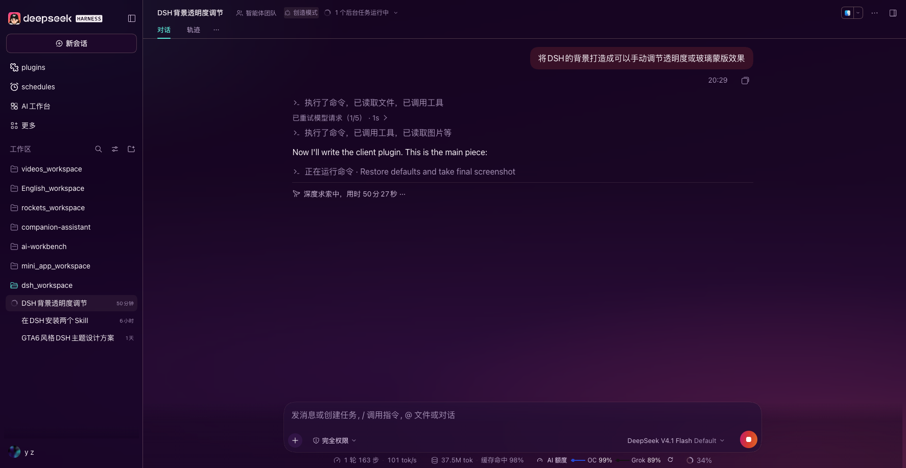
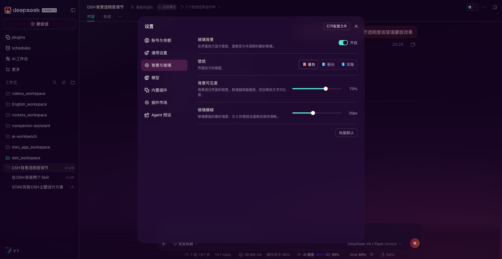
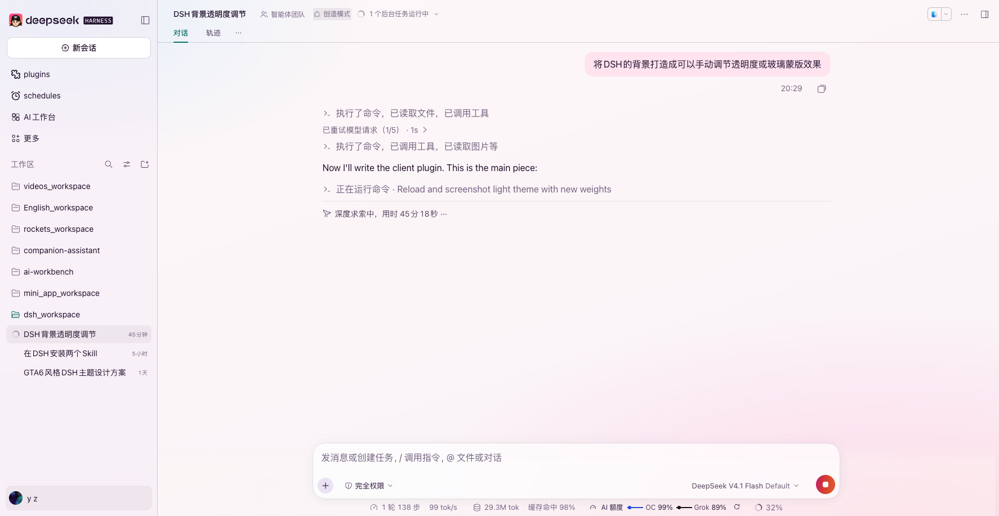

# Glass backdrop · DSH 玻璃背景

给 [DeepSeek Harness](https://github.com/deepseek-ai/dsh) 的 Web 界面加一层**可手动调节的玻璃背景**：界面后方铺一张壁纸，面板变成半透明磨砂玻璃；「背景可见度」和「玻璃模糊」两根滑块随手调。

A **glassmorphism backdrop plugin** for DeepSeek Harness: a wallpaper behind the UI, translucent frosted-glass panels, and two sliders for background visibility and blur.



## 功能 Features

- **壁纸**：内置 3 款原创渐变画面（暮色 / 极光 / 深海），每款都有深色、浅色两套配色，跟随主题自动切换。
- **背景可见度** 0–100%：背景透过界面的程度，越高越通透。
- **玻璃模糊** 0–48px：磨砂强度；为 0 时壁纸在面板后保持清晰。
- **一键开关 / 恢复默认**：关掉后界面立刻回到主题原貌。
- **持久化**：偏好存在浏览器 `localStorage`（键 `dsh.glass-backdrop`），刷新后保留。
- **可访问性**：原生 `range` 滑块、`role="switch"` 开关、`radiogroup` 壁纸选择（支持方向键 / Home / End），焦点环与减弱动效适配。
- 纯 Client 插件，不依赖任何第三方运行时包；兼容深浅色主题与第三方主题（在 Vice Coast 主题下实测）。

### 截图 Screenshots

| 深色（默认） | 设置页 |
| --- | --- |
|  |  |

| 浅色 | |
| --- | --- |
|  | |

## 安装 Install

仓库本身就是一个 DSH bundle（`package.json` 里的 `dsh.bundle.patch` + `dsh.client`），安装方式二选一。

### 方式一：让 DSH Agent 安装（推荐）

克隆到任意稳定目录后，在 DSH 里说：

> 安装 `/绝对路径/dsh-glass-backdrop` 这个 bundle

Agent 会通过 Plugin Manager 的 `install_bundle` 完成依赖链接与 bundle 启用，随后刷新页面即可。

### 方式二：手动安装

```bash
git clone https://github.com/panyz/dsh-glass-backdrop.git ~/dsh-plugins/dsh-glass-backdrop
```

编辑 `$DSH_HOME/profiles/<profile>/package.json`：

```jsonc
{
  "dsh": { "profile": { "bundles": [/* … */, "dsh-glass-backdrop"] } },
  "dependencies": {
    // …
    "dsh-glass-backdrop": "link:/Users/you/dsh-plugins/dsh-glass-backdrop"
  }
}
```

然后在该 profile 目录执行 `dsh plugin --profile <profile> install`（或 `pnpm install`）让链接生效，重启 DSH 或刷新 Web 页面。

> 本插件只声明 Client 半边（`dsh.client`），Host 半边为空（`index.js` 只导出空 `apply`），因此不需要构建步骤，也不需要重启 Host。

## 使用 Usage

打开 **设置 → 背景与玻璃**（Settings → Backdrop & glass），即可调：

| 控件 | 说明 |
| --- | --- |
| 开关 | 关闭后移除壁纸与玻璃层，回到主题原貌 |
| 壁纸 | 暮色 / 极光 / 深海 |
| 背景可见度 | 0–100%，默认 70% |
| 玻璃模糊 | 0–48px，默认 20px |
| 恢复默认 | 暮色 · 70% · 20px |

提示：可见度越高越通透，但文字对比度会下降；想更「抢眼」可把可见度调到 85% 以上，或把模糊降到 10px 以内让壁纸更清晰。

## 工作原理 How it works

1. `client.js` 用一张插件私有样式表把渐变壁纸画在 `body` 上（`background-attachment: fixed`，铺满视口，深浅色分别取 `body[data-ds-dark-theme]`）。
2. 通过 `ctx.theme.overrideTokens()` 叠加一层 token 覆盖：把外框、侧栏、卡片、弹窗等表面的背景色按滑块换算成带 alpha 的 `rgba()`。基础色从主题快照（`ctx.theme.getTheme().active.tokens`）读取，内置主题则回退到计算样式，所以不破坏任何主题的原配色。
3. 在 `#root` 与 `[role="dialog"]` 上加 `backdrop-filter: blur(...)`：一次磨砂整个壁纸，弹窗再单独磨砂自己的背景，保证半透明时文字依然可读。
4. 重新应用 token 层时先撤下旧层再读取基础色，避免把自己上一次的 rgba 当成主题色；主题切换（含跟随系统）通过 `theme/change` 重新计算。

## 配置存储 Storage

| 键 | 值 |
| --- | --- |
| `localStorage["dsh.glass-backdrop"]` | `{ "enabled": true, "wallpaper": "dusk", "visibility": 70, "blur": 20 }` |

按浏览器保存，不写 profile 配置；换浏览器或清空站点数据后回到默认值。

## 目录结构 Layout

```
.
├── package.json        # bundle 清单：dsh.bundle.patch + dsh.client
├── cordis.patch.yml    # 插入 glass-backdrop 插件行
├── index.js            # Host 半边（空实现）
├── client.js           # 全部可见逻辑：壁纸、token 层、设置页
├── locale/{en,zh}.json # 插件清单里的标题与描述
├── icon.svg            # 插件图标
└── docs/               # README 截图
```

## 兼容性 Compatibility

- 在 DeepSeek Harness `0.2.2-rc.1`（web profile）上开发并验证。
- Client 依赖的服务：`theme`、`slots`、`locale`；缺失时插件不会激活。
- 设置页注册在 `settings.section` 槽，壁纸/玻璃效果对客户端其余部分无侵入。

## License

[MIT](LICENSE)
